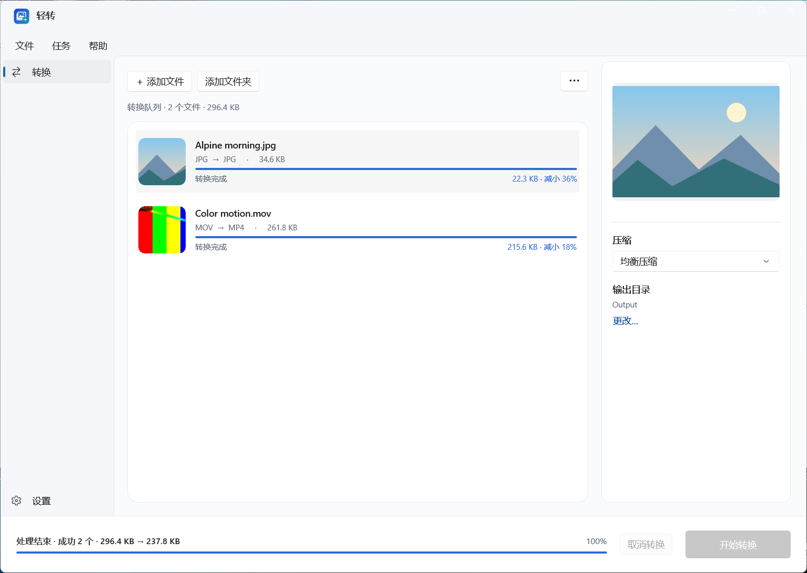
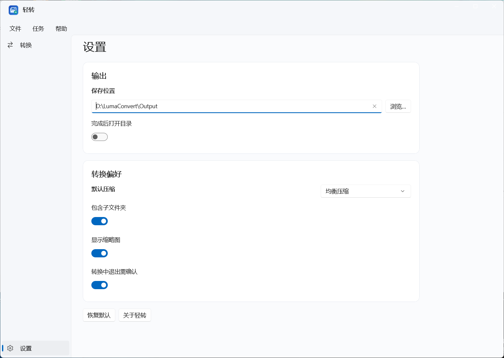

<p align="center">
  
</p>

<h1 align="center">LumaConvert · 轻转</h1>
<p align="center">Batch convert and compress iPhone photos and videos on Windows.</p>
<p align="center">C# · WinUI 3 · 本地处理 · 免安装</p>

把 iPhone 的 HEIC 照片和 MOV 视频批量转成 JPG、MP4。拖入文件，选择压缩档位，开始转换。原文件始终保留。

**[下载 Windows x64 版](https://github.com/zhxil/lumaconvert/releases/latest)** · [构建说明](#从源码构建) · [第三方组件](THIRD_PARTY_NOTICES.md)

## 界面

转换队列、逐文件进度与预览：



输出目录、默认压缩与偏好设置：



截图来自实际 Windows 程序，使用生成的演示素材。当前界面为中文；程序窗口和可执行文件沿用“轻转”和 `LightConvert.exe` 名称。

## 功能

- HEIC / HEIF / JPG / JPEG / PNG → JPG。
- MOV / MP4 → H.264 + AAC 的 MP4。
- 拖拽添加文件或文件夹，支持递归扫描和重复文件过滤。
- 清晰优先、均衡压缩、体积优先三档；缩略图、选中预览及逐文件进度。
- 保留原文件；输出重名自动加序号；取消或失败清理临时文件。
- 设置自动保存；原生菜单、快捷键和高分屏显示支持。
- 图片解码使用短时子进程；缩略图随列表可见区域缓存；限制视频线程和前瞻缓存。

## 使用

1. 从 [Releases](https://github.com/zhxil/lumaconvert/releases/latest) 下载 ZIP 或 7z，解压完整文件夹。
2. 双击 `LightConvert.exe`。请保留同目录下的运行库和 `tools` 文件夹。
3. 添加或拖入媒体，选择压缩方式，然后点击“开始转换”。输出位置可以在设置中修改。

面向 Windows x64，最低目标 Windows 10 2004；推荐 Windows 11。便携包自带 .NET、Windows App SDK 和媒体组件，使用时不需要 Python、开发工具或另装 .NET。

| 档位 | 图片 | 视频 |
| --- | --- | --- |
| 清晰优先 | JPG 质量 92，原分辨率 | CRF 20，原分辨率 |
| 均衡压缩 | JPG 质量 82，最长边 3840 | CRF 25，最长边 1920 |
| 体积优先 | JPG 质量 65，最长边 2560 | CRF 30，最长边 1280 |

转换为有损压缩，输出不保证比原文件小。HDR 视频会进行 SDR 色调映射；真实 Dolby Vision 的色彩准确性尚未完成验证。当前不合并 Live Photo，也不保留全部原始元数据。

## 从源码构建

在 Windows 上安装 [.NET 10 SDK](https://dotnet.microsoft.com/download/dotnet/10.0)、Windows SDK 10.0.26100 或更新版本，以及 PowerShell 7。NuGet 依赖版本由项目和锁文件记录。

```powershell
git clone https://github.com/zhxil/lumaconvert.git
cd lumaconvert

# 从 BtbN 官方发行页下载 FFmpeg 8.1 共享构建，并核对官方 SHA-256。
pwsh -File native/setup-ffmpeg.ps1

# 自包含发布，输出到 dist/轻转-v2.2.1-Windows-x64。
pwsh -File native/build-native.ps1

# 实际媒体组件集成测试：HEIC、视频、进度、重名、取消、损坏输入等。
pwsh -File native/verify-native.ps1
```

如使用项目目录中的 .NET SDK，可向构建与验证脚本传入 `-DotnetPath ./.tools/dotnet/dotnet.exe`。FFmpeg 二进制、SDK 缓存、私人测试媒体和发布包不进入 Git；便携包放在 GitHub Releases。

## 结构

```text
native/
  LightConvert.WinUI/        原生桌面界面与设置
  LightConvert.Core/         图片、视频转换与进度
  LightConvert.ImageWorker/  独立图片解码进程，与主程序共享运行库
  LightConvert.Verify/       实际编解码集成验证
  fixtures/                 生成的 HEIC 测试素材
docs/screenshots/           实际界面截图
```

应用源码采用 [MIT License](LICENSE)。FFmpeg、Magick.NET、Windows App SDK 及其依赖分别遵循各自许可证，详见 [第三方说明](THIRD_PARTY_NOTICES.md) 和便携包的 `licenses` 目录。
